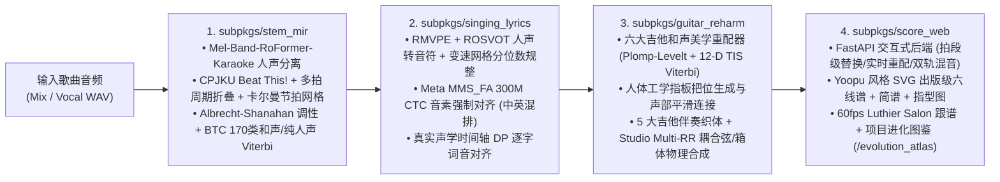

# MelodyDesk 2.0 · 全链路人声驱动木吉他编配与交互式六线谱工作台

**MelodyDesk 2.0** 是一套 **100% 纯人声驱动（Vocal-Driven）** 的自动扒谱、歌词音节强制对齐、六大吉他和声美学重配与高保真木吉他物理建模合成工作台。输入任意带人声的歌曲音频（MP3 / WAV / FLAC / M4A），自动提取主唱简谱、逐字对齐中英文歌词，并围绕人声主旋律生成零小二度冲突、可实时切换把位与伴奏织体的 **有谱（Yoopu）风格交互式吉他六线谱 + 和弦指型图 + 主唱简谱 + 歌词联谱**。

---

## 一、 核心架构与 2026 SOTA 技术栈（四大子包）



### 1. [`subpkgs/stem_mir`](subpkgs/stem_mir) — 人声提取、变速节拍追踪与和声识别/推导
- **主唱人声分离 ([`separator_engine.py`](subpkgs/stem_mir/separator_engine.py))**：采用 MVSEP 榜单冠军架构 `Mel-Band-RoFormer-Karaoke`（`aufr33_viperx_sdr_10.1956.ckpt`）与 `BS-RoFormer` 剥离伴奏与背景和声，输出高纯净度主唱干声。
- **人声节拍与小节线锁定 ([`beat_tracker.py`](subpkgs/stem_mir/beat_tracker.py))**：基于 ISMIR 冠军模型 `CPJKU Beat This!` + 全局一致多拍周期折叠估计器 + 时变卡尔曼滤波节拍追踪器（Time-Varying Kalman Filter），输出支持自由速度（Rubato）的逐拍时间轴 `beat_times` 与逐小节起点 `bar_start_seconds`。
- **混合伴奏识别与纯人声和声合成 ([`chord_recognizer.py`](subpkgs/stem_mir/chord_recognizer.py))**：有伴奏时启用 `BTC 170-Chord` 识别延伸/斜杠/小节内切分和弦；清唱时采用 Albrecht & Shanahan (2013) 调性估计与对数域 Viterbi 动态规划，直接从主唱旋律推导出和谐的基础和弦序列。

### 2. [`subpkgs/singing_lyrics`](subpkgs/singing_lyrics) — 人声转简谱与音节级歌词强制对齐
- **人声转音符与乐谱规整 ([`singing_transcriber.py`](subpkgs/singing_lyrics/singing_transcriber.py))**：结合 `RMVPE` 深度基频提取与 `ROSVOT` 音符边界检测，在真实变速节拍网格（Piecewise Beat Grid）上进行自适应分位数装饰音过滤、微颤音合并与小节线对齐。
- **中英混排音节级强制对齐 ([`lyric_aligner.py`](subpkgs/singing_lyrics/lyric_aligner.py))**：使用 Meta `MMS_FA` 300M CTC 强制对齐模型（配合 `pypinyin` 汉字转罗马音与 Needleman-Wunsch 全局序列投影）提取每个字/词的精确声学起止秒数，再通过声学交集动态规划将歌词逐字挂载到简谱音符与一字多音延音线（`-`）上。

### 3. [`subpkgs/guitar_reharm`](subpkgs/guitar_reharm) — 六大吉他和声美学、人体工学把位与物理建模合成
- **六大吉他和声美学重配器 ([`reharmonizer.py`](subpkgs/guitar_reharm/reharmonizer.py))**：基于 12 维 TIS（Tonal Interval Space）相位协和度与 Plomp-Levelt / Sethares 多泛音粗糙度曲线做 Viterbi 解码，严格拦截小二度（`minor_ninth`）碰撞：
  1. **`original`（原版和弦 · Original）**：忠实保持原曲基础三/七和弦与主唱旋律严密协和。
  2. **`folk_easy`（民谣简化 · Folk Easy）**：简化复杂延伸音，优先第一把位开放易按指型。
  3. **`emotional_pop`（流行走心 · Emotional Pop）**：引入 `Imaj7`、`IVadd9`、`vi7`、`sus4 -> 3` 延留解决与借用小四级 `iv6`。
  4. **`neosoul_jazz`（Neo-Soul 爵士 · Maj7/m9）**：扩展 `Maj9 / m9 / 9 / 7sus4` 色彩和弦、三全音代理（$\text{bII7}$）与后门进行（$\text{iv7} \to \text{bVII9} \to \text{Imaj9}$）。
  5. **`walking_bass`（顺阶低音 · Walking Bass）**：强化转位斜杠和弦（`C/E`、`G/B`、`Am7/G`）与小节内切分双和弦构成顺阶低音线。
  6. **`suspend_dreamy`（空灵挂留 · Sus2/Sus4）**：运用 `sus2` / `7sus4` 挂留色彩营造开阔木吉他泛音空间感。
- **人体工学指板把位 ([`chord_voicing.py`](subpkgs/guitar_reharm/chord_voicing.py))**：按毫米级指距舒适度、横按可行性与相邻拍段声部平滑连接（Voice-Leading）生成真实可按的六弦指法图。
- **五大伴奏织体、MelodyT5 独奏编配与物理建模合成 ([`arrangement_grooves.py`](subpkgs/guitar_reharm/arrangement_grooves.py)、[`melodyt5_bridge.py`](subpkgs/guitar_reharm/melodyt5_bridge.py) & [`guitar_simulator.py`](subpkgs/guitar_reharm/guitar_simulator.py))**：支持 **分解和弦、扫弦伴奏、指弹律动、Neo-Soul 律动、抒情琶音** 五大核心织体，配合经过低音（`PB`）、击勾弦（`H/P`）、拍弦（`X`）、闷音（`PM`）、前间奏双音对位（`DS`）/滑音（`SL`），通过 Studio Multi-RR 采样与耦合弦箱体共鸣合成温润木吉他音频。

### 4. [`subpkgs/score_web`](subpkgs/score_web) — 交互式曲谱工作台与项目进化图鉴
- **Web 服务端 ([`server.py`](subpkgs/score_web/server.py))**：提供 FastAPI 实时重配、小节及分拍段（`bar:segment`）和弦替换与把位切换、变调夹（Capo `0..12`）移调、双轨独立混音试听，以及离线交互式 **项目进化图鉴**（`http://127.0.0.1:7865/evolution_atlas` 或 [`static/evolution_atlas.html`](static/evolution_atlas.html)）。
- **出版级 SVG 联谱渲染 ([`yoopu_svg_renderer.py`](subpkgs/score_web/yoopu_svg_renderer.py))**：按真实节拍比例精确排布切分和弦指型图网格、六线谱（TAB）、带减时线的主唱简谱（Jianpu）与逐字对齐歌词，支持 60fps 游标跟弹与 A–B 小节循环练琴。

---

## 二、 快速启动

### 0. Windows 免安装独立便携版（推荐，零环境依赖）
前往 [**GitHub Releases**](https://github.com/Lkkisme/melodydesk-workbench/releases/latest) 下载最新 `MelodyDesk-v2.0.1-win-x64.zip`，完整解压至任意目录后双击 **`MelodyDesk.exe`** 即可启动（已内置 Python 运行时、FFmpeg、987 个原木吉他采样、7 首真唱全曲曲库，以及全套离线人声分离 MDX-Net DirectML、Whisper-Small int8、Beat This!、BTC 与 RMVPE/ROSVOT 模型权重，断网可直接上传任意 MP3/WAV/FLAC/M4A 歌曲极速扒谱）。

如需从源码自行打包 Windows `.exe` 发行包：
```powershell
python release_builder/build_release.py --version 2.0.1
```

### 1. 源码开发环境准备
需要 **Python 3.11 / 3.12** 与 **FFmpeg**（已加入系统 `PATH`）。安装依赖：

```powershell
python -m venv .venv
.\.venv\Scripts\Activate.ps1
pip install -r requirements.txt
```

### 2. 启动 Web 交互式吉他编配与曲谱工作台（推荐）
```powershell
python web_server.py --host 127.0.0.1 --port 7865
```
启动后在浏览器打开 `http://127.0.0.1:7865`（点击顶栏「进化图鉴」或访问 `http://127.0.0.1:7865/evolution_atlas` 可体验三阶段 8s 交互声学演示）：
- 在左侧曲库切换预置真唱曲目（《成都》《普通朋友》《Take Me Home, Country Roads》《Tears in Heaven》《Scarborough Fair》《Greensleeves》《Let's Go Fishin'》）或上传自定义歌曲音频；
- 实时切换 **六大和声美学预设**、**五大伴奏织体风格**、**变调夹（Capo）**、**低音经过音 / 小节内切分加密 / 拍弦 / 闷音 / 击勾弦装饰**；
- 点击谱面任意小节或分拍段直接试听并替换候选替代和弦、切换不同把位指法。

### 3. 启动本地桌面版工作台
```powershell
python app.py
```

---

## 三、 运行测试与全链路校验

```powershell
# 运行全部 4 大子包单元测试与全链路法医回归测试（86+ 项测试）
python -m pytest subpkgs test_forensic_regression.py -q
```
