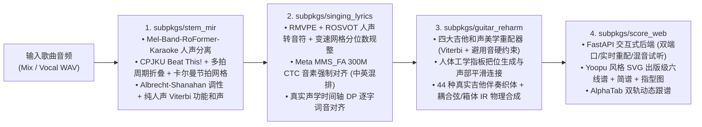

# MelodyDesk 2.0 · 全链路人声驱动木吉他编配与交互式六线谱工作台

**MelodyDesk 2.0** 是一套 **100% 纯人声驱动（Vocal-Driven）** 的自动扒谱、歌词音节强制对齐、四大吉他和声美学重配与高保真木吉他物理建模合成工作台。输入任意带人声的歌曲音频（MP3 / WAV / FLAC / M4A），自动提取主唱简谱、逐字对齐中英文歌词，并围绕人声主旋律生成零小二度冲突、可实时切换把位与伴奏织体的 **有谱（Yoopu）风格交互式吉他六线谱 + 和弦指型图 + 主唱简谱 + 歌词联谱**。

---

## 一、 核心架构与 2026 SOTA 技术栈（四大子包）



### 1. [`subpkgs/stem_mir`](subpkgs/stem_mir) — 人声提取、变速节拍追踪与纯人声功能和声推导
- **主唱人声分离 ([`separator_engine.py`](subpkgs/stem_mir/separator_engine.py))**：采用 MVSEP 榜单冠军架构 `Mel-Band-RoFormer-Karaoke`（`aufr33_viperx_sdr_10.1956.ckpt`）与 `BS-RoFormer` 剥离伴奏与背景和声，输出高纯净度主唱干声。
- **人声节拍与小节线锁定 ([`beat_tracker.py`](subpkgs/stem_mir/beat_tracker.py))**：基于 ISMIR 冠军模型 `CPJKU Beat This!` + 全局一致多拍周期折叠估计器 + 时变卡尔曼滤波节拍追踪器（Time-Varying Kalman Filter），输出支持自由速度（Rubato）的逐拍时间轴 `beat_times` 与逐小节起点 `bar_start_seconds`。
- **100% 纯人声旋律条件化和声合成 ([`chord_recognizer.py`](subpkgs/stem_mir/chord_recognizer.py))**：采用 Albrecht & Shanahan (2013) 12 维音高类长时分布估计调性，并在对数域 Viterbi 动态规划上结合小节时值权重、强拍锚点、终止式（Cadence）与声部五度圈进行，直接从主唱旋律推导出和谐的基础和弦序列。

### 2. [`subpkgs/singing_lyrics`](subpkgs/singing_lyrics) — 人声转简谱与音节级歌词强制对齐
- **人声转音符与乐谱规整 ([`singing_transcriber.py`](subpkgs/singing_lyrics/singing_transcriber.py))**：结合 `RMVPE` 深度基频提取与 `ROSVOT` 音符边界检测，在真实变速节拍网格（Piecewise Beat Grid）上进行自适应分位数装饰音过滤、微颤音合并与小节线对齐。
- **中英混排音节级强制对齐 ([`lyric_aligner.py`](subpkgs/singing_lyrics/lyric_aligner.py))**：使用 Meta `MMS_FA` 300M CTC 强制对齐模型（配合 `pypinyin` 汉字转罗马音与 Needleman-Wunsch 全局序列投影）提取每个字/词的精确声学起止秒数，再通过声学交集动态规划将歌词逐字挂载到简谱音符与一字多音延音线（`-`）上。

### 3. [`subpkgs/guitar_reharm`](subpkgs/guitar_reharm) — 四大吉他演奏美学、人体工学把位与物理建模合成
- **四大吉他和声美学重配器 ([`reharmonizer.py`](subpkgs/guitar_reharm/reharmonizer.py))**：
  1. **`original`（保留原曲）**：忠实保持基础自然音阶三/七和弦与主唱旋律零冲突对齐。
  2. **`emotional_pop`（流行抒情重配 · C-Pop / J-Pop 指弹美学）**：引入 `add9`、`maj7`、`sus4 -> 3` 延留解决、大调 `IV -> iv6` 小四级借用与副属和弦（`V7/vi`、`V7/ii`），严格拦截任何与主唱旋律形成小二度（`interval == 1`）的刺耳碰撞。
  3. **`neosoul_jazz`（Neo-Soul / 爵士色彩 · R&B 美学）**：扩展 `9` / `11` / `13` 延伸和弦、Tritone Substitution（三全音代理 $\text{bII7}$）与 Backdoor Progression（$\text{iv7} \to \text{bVII9} \to \text{Imaj9}$）。
  4. **`folk_acoustic`（民谣指弹 · Tommy Emmanuel / 押尾コータロー 低音声部行进美学）**：强化第一转位斜线和弦（`I -> V/7 -> vi -> I/5 -> IV -> I/3`）与开放弦共鸣，令吉他在伴奏同时自带顺滑的 Bassline 旋律线。
- **人体工学指板把位 ([`chord_voicing.py`](subpkgs/guitar_reharm/chord_voicing.py))**：根据物理跨度（4 品以内）、横按惩罚、低音弦浑厚度与相邻小节把位平滑转移生成真实可按的六弦指法图。
- **44 种伴奏织体与物理建模合成 ([`arrangement_grooves.py`](subpkgs/guitar_reharm/arrangement_grooves.py) & [`guitar_simulator.py`](subpkgs/guitar_reharm/guitar_simulator.py))**：支持分解和弦、抒情琶音、指弹律动、Neo-Soul 律动、Bossa Nova、Travis Picking、民谣扫弦及击弦/勾弦（`H/P`）、拍弦（`Slap X`）、闷音（`PM`），并通过耦合弦合成与木吉他箱体脉冲响应（Body IR）生成真实感木吉他音频。

### 4. [`subpkgs/score_web`](subpkgs/score_web) — 交互式曲谱工作台
- **Web 服务端 ([`server.py`](subpkgs/score_web/server.py))**：提供 FastAPI 实时重配、单小节和弦替换建议、把位切换、变调夹（Capo `0..7`）移调、以及「人声 + 木吉他伴奏混音」「纯木吉他伴奏」「纯人声」三路实时音频流。
- **出版级 SVG 联谱渲染 ([`yoopu_svg_renderer.py`](subpkgs/score_web/yoopu_svg_renderer.py))**：自动渲染和弦指型图网格、六线谱（TAB）、带减时线的主唱简谱（Jianpu）与逐字对齐歌词。

---

## 二、 快速启动

### 1. 环境准备
需要 **Python 3.11 / 3.12** 与 **FFmpeg**（已加入系统 `PATH`）。安装依赖：

```powershell
python -m venv .venv
.\.venv\Scripts\Activate.ps1
pip install -r requirements.txt
```

### 2. 启动 Web 交互式吉他编配与曲谱工作台（推荐）
```powershell
python web_server.py --host 127.0.0.1 --port 7865
```
启动后在浏览器打开 `http://127.0.0.1:7865` 即可：
- 在顶部曲库下拉框切换预置真唱曲目（《成都》《普通朋友》《Take Me Home, Country Roads》《Tears in Heaven》《Scarborough Fair》《Greensleeves》《Let's Go Fishin'》）或上传自定义歌曲音频；
- 实时切换 **四大和声美学预设**、**伴奏织体风格**、**变调夹（Capo）**、**低音经过音 / 小节内切分加密 / 拍弦 / 闷音 / 击勾弦装饰**；
- 点击谱面任意小节直接试听並替换候选替代和弦或切换不同把位指法。

### 3. 启动本地桌面版工作台
```powershell
python app.py
```

---

## 三、 运行测试与全链路校验

```powershell
# 运行全部 4 大子包单元测试与全链路法医回归测试（共 27 项测试）
python -m pytest subpkgs test_forensic_regression.py -q
```
